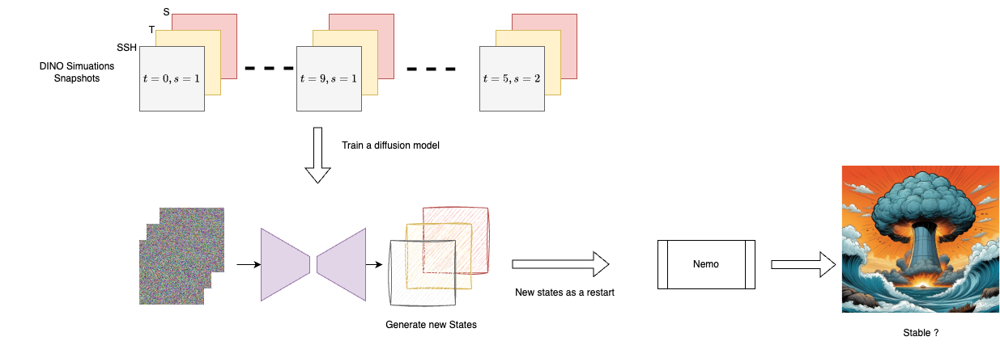

# DINO Fusion

Code of *Physically Consistent Sampling For Ocean Model Initialization* (Tackling Climate Change with Machine Learning workshop, NeurIPS 2025).

A diffusion model is trained on post spin-up states (temperature, salinity, SSH) of the DINO configuration of NEMO, then sampled with or without physical constraints, and the generated states are evaluated before (a priori) and after (a posteriori) reintroduction in NEMO.



## Layout

```
Diffusion_Model/          training and generation
  DataLoader.py, TransformFields.py   data loading and invertible transformation (stride, concat, normalise, mask, pad)
  train/                  train.py (training loop, config in configs/base_config.py), DiffusionModel.py, backbones/ (UNet), utils.py (save_images)
  generate.py             sample states, optionally constrained by a loss of pipelines/losses.py
  pipelines/              State.py (observation operators : density, profiles), losses.py (per-sample losses, projections),
                          sampling.py (sampling loop), pipeline_tensor.py (diffusers pipeline of the model)
  post_processing.py      un-normalise generated states -> <name>_clean/{toce,soce,ssh}.npy
Results/
  analysis_scripts/       shared code : EOS density and box metrics (metrics.py), mesh mask, mean density profile of the training set
  a_priori/               metrics on the generated states (paper Figures 2-3, Tables 1-2)
  a_posteriori/           generated state -> NEMO restart, NEMO run, density after integration (see its README)
  archived/               (not tracked) figures and tables of the former beta / projection sweeps
scripts/xarray_numpy.py   build the training archive from DINO outputs
```

## Data and model

All paths are relative to the `OCEANDATA` environment variable, which must be set before running anything :

```bash
export OCEANDATA=/Volumes/LoCe/oceandata/
```

| What | Path in `$OCEANDATA` |
| --- | --- |
| Training archive (1800 states, T/S (36, 199, 62) and SSH, 1° DINO, with normalisation infos) | `Dino-Fusion/dino_1_4_degree_coarse_240125.tar` |
| Model of the paper (`3-std` normalisation) | `models/dino-fusion/tav0h83b/` |
| Generated states of the paper (C1, C2, TS) | `models/dino-fusion/Publication-Blandine/generated_npy_files/` |
| Generated states without constraint (8 and 200 states) | `models/dino-fusion/tav0h83b/inference/infesteps_1000/constraints_no_constraints/{20250131-110120,20250203-141645}_clean` |

Environment : `Diffusion_Model/diffusion-env.yml` (+ `accelerate`, `tensordict`, `einops`, `xarray`, `cmocean`, `cartopy`, `seaborn`, `pandas` for the analysis).

## 1. Train

```bash
cd Diffusion_Model
accelerate launch train/train.py
```

Hyper-parameters are in `configs/base_config.py` (`TrainingConfig`). Every `generation_frequency` epochs the model is saved in `base_output_dir/<wandb id>/` with sample generations.

## 2. Generate

```bash
python Diffusion_Model/generate.py --model_path $OCEANDATA/models/dino-fusion/tav0h83b --batch 8 --loss <loss> --eta <eta> --eps <eps>
```

`pipelines/sampling.sample` runs DDPM sampling with, for each sample of the batch, a primal-dual constraint `loss(x) <= eps` (PD-LMC, Chamon et al. 2025) evaluated on the Tweedie estimate with the gradient through the UNet (DPS, Chung et al. 2023) :

```
x0_hat  = clip((x_t - sqrt(1 - abar_t) * eps_theta(x_t)) / sqrt(abar_t), -1, 1)
g       = loss(x0_hat) - eps                         (b,)   --mode raw (default)
        = sqrt(loss(x0_hat)) - sqrt(eps)                    --mode sqrt
x_{t-1} = DDPM(x_t) - grad_{x_t} sum_i lbd_i * g_i
lbd     <- max(lbd + eta * g, 0)                     lbd_0 = 0
```

`BorderZero` is applied on the state after each step.

| `--loss` | Constraint |
| --- | --- |
| `mean_density` | mean density profile of the training set (strided levels) |
| `mean_grad_density` | mean vertical density gradient of the training set |
| `negative_grad_density` | penalise inversions of the mean density profile |
| `zero_mean` | zero spatial mean of each normalised level |
| `dist_isoton` | squared distance of each density column to the isotonic cone |

Without `--loss`, plain DDPM sampling is run. The output folder `<model_path>/inference/<prefix>/<loss or none>/<time>/` (`--prefix` defaults to today's date, ddmmyy) contains `generated.npy` (normalised), `lbd.npy` (final dual variables), `args.json` and `clean/{toce,soce,ssh}.npy` (un-normalised, input of the a priori evaluation). New losses are added in `pipelines/losses.py` (a `Loss` maps the normalised state (b, c, i, j) to (b,)) and registered in `get_loss`.

The generations of the paper (constraints TS, C1, C2) were produced by a former code, removed from the repository; they are stored in `models/dino-fusion/Publication-Blandine/generated_npy_files/`. The generations and sweeps of the former gradient / projection methods are archived in `models/dino-fusion/tav0h83b/inference/archived/`.

## 3. A priori evaluation

Run from `Results/a_priori/` with `--set paper` (generations of the paper, default). `--gens` selects the generations to plot. Sets are defined in `load_data.py`, figures are saved in `Results/a_priori/figures/<set>/`.

| Script | Content (paper) |
| --- | --- |
| `spatial_structure.py` | T and S at the surface and at 340 m, data vs generations (Figure 2 left) |
| `variability.py` | point by point variance of SST / SSS (Figure 2 right) and mean variance (Table 2) |
| `box_metrics.py` | Bottom-Water / Deep-Water T and S, density errors (Table 1) |
| `density.py` | zonally averaged density of the generated states |

## 4. A posteriori evaluation

See [Results/a_posteriori/README.md](Results/a_posteriori/README.md) : conversion of a generated state into a NEMO restart, launch of the run, and density figures (paper Figures 3 and 4).
