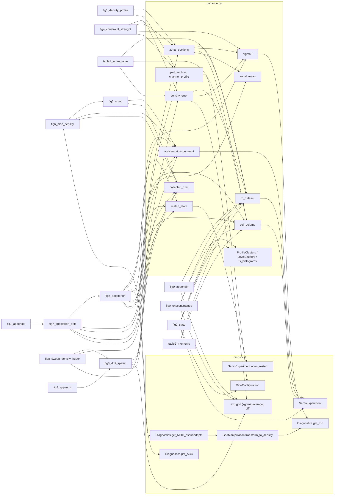

# Call graph of the paper-clean scripts

Each script of this folder builds one figure or table of the paper from the objects loaded by `common.py`. Everything that dinostics (`Results/a_posteriori/dinostics`) computes is taken from it: the grids, masks and metrics come from its `NemoExperiment` (`experiment.py`), the density from `Diagnostics.get_rho` (S-EOS of the run namelist) for the density-space overturning only, the channel transport from `Diagnostics.get_ACC`, the density-space overturning from `Diagnostics.get_MOC_pseudodepth` and `GridManipulation.transform_to_density`, the channel latitudes from `DinoConfiguration`, and the horizontal means and vertical differences from the xgcm grid that `NemoExperiment` builds (`exp.grid`). sigma_0 everywhere else is the TEOS-10 polynomial of `Results/analysis_scripts/metrics.get_density_at_surface` (`common.sigma0`, `common.teos_sigma0`), the EOS the training constraint uses (`Diffusion_Model/pipelines/State.py`), as in the paper/ scripts. The few quantities dinostics has no routine for are written in `common.py` when several scripts use them, in the script otherwise, in the same style, on these objects. Each script splits into `compute()` (what is loaded and the computation of the signal, returned as a dict), `plot(computed)` (`table(computed)` for the tables: the figure(s) or the LaTeX table, colour scales and layout, without saving) and `main()` (compute, plot, save into FIGURES). `paper_figures.ipynb` is generated from the scripts by `build_notebook.py` (`python build_notebook.py`): the standalone `fig_huber`, the loading cells, the shared sigma_0 computations of `common.py`, then per script its docstring, a cell `from <script> import *` with the source of the helpers its `compute` calls, the body of `compute` inline and `plot(computed)`. The notebook saves nothing.

The data states are the 16 normalized training states of the a posteriori data run (`<INFERENCE>/optimal/data/<timestamp>/states.npy`, `common.batch`), so no script uses the DataLoader. The one exception is the one-off `build_reference_density.py`, not imported by anything: it draws the 200-state data batch (first 200 states of the shuffle seeded with DATA_SEED) and writes its batch-mean zonal sigma_0 section (TEOS-10, (z_c - 1, y_c)) to `<INFERENCE>/optimal/reference_density/reference_density.npy` with a json descriptor. `common.REFERENCE_DENSITY` holds that section; it is used only as the reference of the fig1 median member, the criterion of the a posteriori selection (`aposteriori/selection.json`). Every other data quantity (data-mean sections of fig1 and fig5, fig4, table1, table2, the cluster fits of fig0 and fig2, the fig0_appendix states) is computed on the 16 states. With the stored reference, the RMSE of the 16 data states reproduces the `rmse_members` of the data selection (paper/ scripts) within 2.5e-10 kg m-3, same member 7.

Two grids are used. `GRID` is the `NemoExperiment` of the 1° reference run (`1deg_restart`), the grid of the training states and of the generations (`to_dataset` puts a batch on its T grid). `aposteriori_experiment` builds the `NemoExperiment` of the 1/4° reference run (`restart25_arch`) and opens the NEMO outputs of an a posteriori run in `exp.data` with `xnemogcm.open_nemo` on its domain, as `NemoExperiment.open_data` does.

| Script | Output (in `figures/`) | dinostics | Local helpers (`common.py` unless noted) |
|---|---|---|---|
| `fig_huber.py` | `fig_huber.pdf` | none (analytical curve) | `h` (script) |
| `fig0_unsconstrained.py` | `fig0_unconstrained/{T_5m,S_136m,clusters_5m,clusters_136m}.pdf` | `GRID.mask` (tmask, glamt, gphit, gdept_1d), `GRID.grid.average` over X, Y (level means) | `to_dataset`, `setup_map`, `LevelClusters` (k-means), `teos_sigma0`; `anomalies` (script) |
| `fig0_appendix.py` | `fig0_appendix.pdf` | `GRID.grid.average` over X, Y (level means), `GRID.mask.gdept_1d` | `to_dataset` |
| `fig1_density_profile.py` | `fig1/{fig1a,fig1b,fig1_appendix}.pdf` | `metrics.get_density_at_surface`, `GRID.mask` metrics, `DinoConfiguration` channel latitudes | `zonal_sections` (`sigma0`, `cell_volume`, `zonal_mean`), `rmse`, `plot_section`, `channel_profile`; `median_member` (script) |
| `fig2_state.py` | `fig2_state.pdf`, `fig2_state_appendix.pdf` | `GRID.mask` metrics, TEOS-10 (isopycnals), `DinoConfiguration` channel latitudes (T-S regions) | `to_dataset`, `cell_volume`, `setup_map`, `teos_sigma0`, `ProfileClusters` (k-means), `ts_histograms`; `fields`, `batch_state`, `plot_grid` (script) |
| `fig4_constraint_strenght.py` | `fig4_constraint_strength.pdf` | `metrics.get_density_at_surface`, `GRID.grid.diff` along Z, `GRID.mask` metrics | `density_error`, `zonal_sections`, `sigma0`, `plot_section`, `by_timestamp`; `load_sweep`, `ocean_sigma0` (script) |
| `table1_score_table.py` | `table1_score_table.tex` | `GRID.mask` (gphit, gdept_0, metrics), TEOS-10 via `density_error` | `to_dataset`, `cell_volume`, `density_error`; `scores` (script) |
| `table2_moments.py` | `table2_moments.tex` | `GRID.mask` metrics | `to_dataset`, `cell_volume`; `training_moments`, `batch_moments`, `scores` (script) |
| `fig5_aposteriori.py` | `fig5_aposteriori.pdf`, `aposteriori/density_2m.pdf` | `NemoExperiment` (1/4°), `NemoExperiment.open_restart`, `metrics.get_density_at_surface`, `Diagnostics.get_ACC` | `aposteriori_experiment`, `restart_state`, `zonal_mean`, `cell_volume`, `zonal_sections`, `rmse`, `plot_section`, `collected_runs`; `restart`, `run`, `to_lat`, `plot_diff` (script) |
| `fig6_amoc.py` | `fig6_amoc.pdf`, `aposteriori/amoc.pdf` | `NemoExperiment` (1/4°), `exp.domain.e1v`, `exp.mask.vmask`, the summation of `Diagnostics.get_MOC` | `aposteriori_experiment`, `collected_runs`; `last_outputs`, `period`, `mean_moc`, `scale`, `panel_grid`, `panel` (script) |
| `fig6_moc_density.py` | `fig6_moc_density.pdf`, `fig6_moc_sigma.pdf`, `aposteriori/{moc_density,moc_sigma}.pdf` | `Diagnostics.get_MOC_pseudodepth`, `GridManipulation.transform_to_density`, `Diagnostics.get_rho` | `aposteriori_experiment`, `collected_runs`; `last_outputs`, `period`, `scale`, `panel_grid` and the constants of fig6_amoc; `experiment`, `mean_moc_density`, `panel`, `vertical_axis` (script) |
| `fig7_aposteriori_drift.py` | `fig7/fig7_drift_{toce,soce}.pdf` | `NemoExperiment` (1/4°), `NemoExperiment.open_restart`, `exp.mask` metrics | `aposteriori_experiment`, `restart_state`, `cell_volume`, `collected_runs`; `METHODS`, `COLORS`, `EXPERIMENT` of fig5; `drift` (script) |
| `fig7_appendix.py` | `fig7/fig7_appendix_drift_{toce,soce}.pdf` | as fig7 | `compute`, `plot`, `main` of fig7 |
| `fig8_drift_spatial.py` | `fig8_drift_spatial.pdf` | `NemoExperiment` (1/4°), `NemoExperiment.open_restart`, `exp.grid.average` over X, Y | `aposteriori_experiment`, `restart_state`, `setup_map`, `collected_runs`; `column_rmse`, `plot_maps` (script) |
| `fig8_appendix.py` | `fig8_appendix_drift_spatial.pdf` | as fig8 | `compute`, `plot`, `main` of fig8 |
| `fig8_sweep_density_huber.py` | `fig8_sweep_density_huber.pdf`, `fig8_sweep_density_huber_vs_eta.pdf`, `fig8_correlation.pdf` | as fig8, plus `metrics.get_density_at_surface` and `GRID.grid.diff` via `density_error` | `column_rmse`, `plot_maps` of fig8, `density_error`, `collected_runs`; `load_runs`, `plot_vs_eta`, `plot_correlation` (script) |
| `build_reference_density.py` | `<INFERENCE>/optimal/reference_density/reference_density.{npy,json}` (one-off) | `NemoExperiment` (1°), `metrics.get_density_at_surface` | `sections` (script, as `zonal_sections`) |
| `compare_eta.py` | `eta_compare/eta10_vs_eta30.pdf` | none (reruns the scripts above with two density runs and assembles the pages) | `render`, `assemble` (script) |
| `build_notebook.py` | `paper_figures.ipynb` | none (per script above: docstring, helpers and body of its `compute`, call of its `plot`) | `markdown`, `function_source`, `shown_helpers`, `inline`, `section`, `shared`, `build` (script) |

## Pieces without a dinostics routine

- Zonal mean (`zonal_mean`): volume-weighted (e1t e2t e3t) mean along x, the weights of the volume used in dinostics (`(mask.e1t * mask.e2t * mask.e3t_0).where(mask.tmask == 1.0)`). `xgcm.Grid.average` over X would weight by e1t only, and the NEMO domain read by `NemoExperiment` holds `e3t_0`, which `xnemogcm.get_metrics` does not register as a Z metric.
- Density inversions (`density_error`): `Diagnostics.get_N_squared` clips N^2 below 1e-8 to 1e-7, which removes the sign that marks an inversion, so the vertical difference of sigma_0 is taken with `exp.grid.diff` along Z as get_N_squared does, and its negative values are weighted by the W-cell volume e1t e2t e3w_0. `sigma0` casts T, S to float64: in float32 rho near 1000 is rounded to 1.2e-4 kg m-3, which turns the near-zero vertical differences of the data (pairs of levels with almost equal T, S) into ties and brings the data density error from 0.38% down to 0.003%.
- Density off the model grid (`teos_sigma0`: fig2 isopycnals, order of the k-means clusters): the TEOS-10 polynomial on raw (T, S) arrays, without the land mask `sigma0` applies.
- Restart fields (`restart_state`): `NemoExperiment.open_restart` keeps the restart dimensions (nav_lev, y, x); they are renamed onto the grid dimensions (z_c, y_c, x_c and x_f for U), the reverse of what `GridManipulation.regrid_restart` does to the mask.
- Depth-space overturning (fig6_amoc): `get_MOC` only computes the density-space MOC; the depth-space one sums the same transport `voce_e3v e1v` over x and cumulates it over the levels.
- Interpolation of 1/4° sections to the 1° latitudes (fig5): `GridManipulation.coarsen_weighted` is hard-coded for 1/16° to 1/4°, so the sections are linearly interpolated in latitude.
- k-means clusters and T-S histograms (fig0, fig2: `LevelClusters`, `ProfileClusters`, `ts_histograms`) are those of the density viewer (`notebooks/machine`), rewritten in `common.py`, on fields and metrics read from `GRID`; the clusters are numbered by the TEOS-10 sigma_0 of their centre (`teos_sigma0`), as in the viewer.
- Training-set moments (table2) are read from the training archive.

## Differences from the paper/ scripts

Measured by running both versions on the same batch, generations and a posteriori runs (sweep `optimal`, run `tav0h83b`).

| Figure | Change | Size of the gap | Reason |
|---|---|---|---|
| fig1, fig2, fig4, fig5 (sigma_0) | none: TEOS-10 polynomial (`metrics.get_density_at_surface`), contour levels `SIGMA_LEVELS` 22 to 28.5 by 0.5 and inset range `PROFILE_RANGE` 25 to 28.5, as in the paper scripts | none | the EOS of the training constraint; only fig6_moc_density uses the model S-EOS (`Diagnostics.get_rho`), the density the a posteriori circulation is run in |
| table1, fig4, fig8_sweep (density error) | inversions weighted by e1t e2t e3w_0 on the W points of `exp.grid.diff` instead of the volume of the lower T cell | data 0.4 -> 0.4 %, no constraint 24.3 -> 24.1, boundary projection 8.3 -> 8.4, eta 30 1.7 -> 1.8, T,S mean 1.3 -> 1.3; fig4 curve within 0.06 % (eta 0 9.28 -> 9.34) | e3w_0 is the thickness of the interface where the difference is taken. The data value comes from pairs of nearly identical levels whose differences are round-off (dT ~ 2e-6 °C): it is a noise floor under either EOS, not inversions |
| table1 (box metrics) | box depth from the 3D gdept_0 instead of gdept_1d | DW T of the data 5.64 -> 5.63 °C, same at one decimal | the depth of the cell |
| fig0_appendix, fig0_unconstrained | level means area-weighted (`exp.grid.average` over X, Y) instead of unweighted over the ocean cells | basin-mean T higher by up to 4.1 °C near the surface (data), 3.4 °C (no constraint), 0 below 3000 m; level correlations within 0.02; cluster labels of the maps agree on 99 % (data) and 95 % (no constraint) of the cells | the unweighted mean over-weights the small high-latitude cells |
| fig1, fig2, fig4, fig5 (channel) | channel latitudes from `DinoConfiguration` (-65, -45) for every figure; paper fig2 used the rows where the surface is ocean at every longitude (`build_density_viewer.acc_mask`) | fig2 T-S channel region +1 row (-45.35°, 2 land cells of 62), +4 % volume; fig1 to fig5 unchanged (they already used -65, -45) | one definition of the channel for all the figures |
| fig5 a (transport) | `Diagnostics.get_ACC` (uoce e3u_0 e2u through x_f = 0) instead of the time-varying uoce_e3u through interior column 1 | at most 0.4 Sv on ~190 Sv | dinostics routine; the transport through any meridional line of the channel is the same up to the volume change between them |
| fig6_amoc, fig6_moc_density, fig7, fig8, table2 | none | fig6_amoc psi equal to 1e-4 Sv, fig7 drifts and fig8 maps to 1e-6, table2 identical; fig6_moc_density calls the same dinostics routines with the same wrapper as the paper script | |
