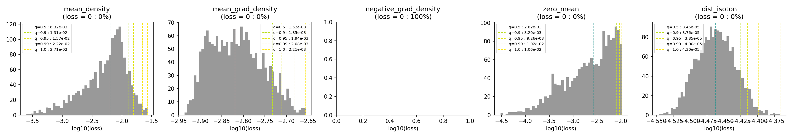
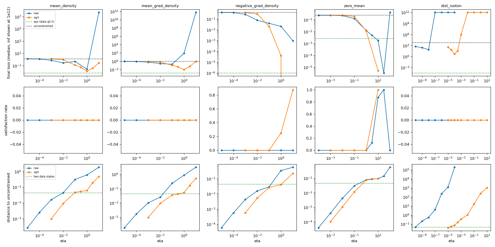
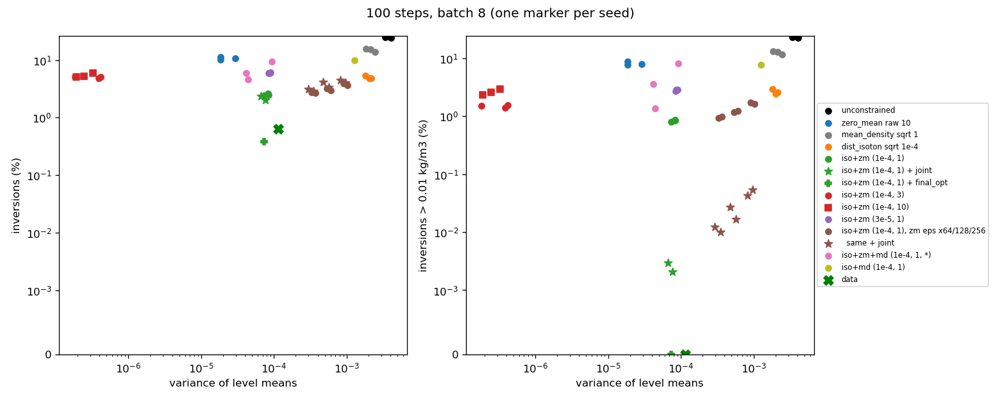
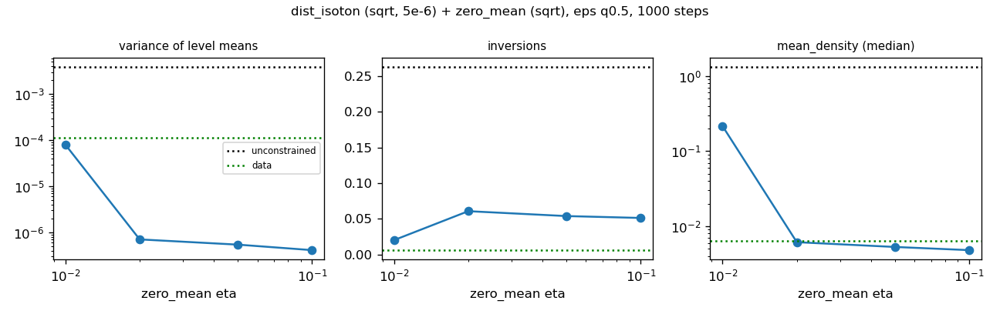
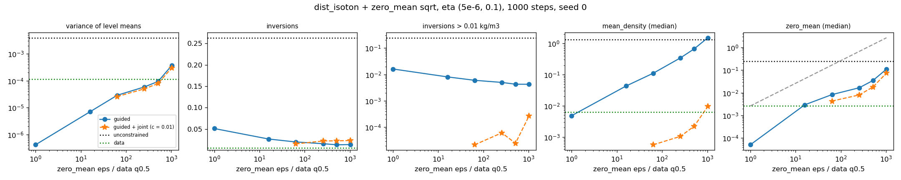
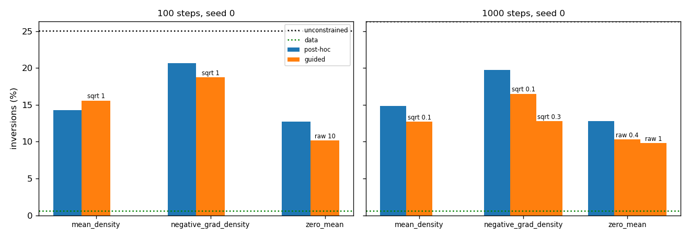
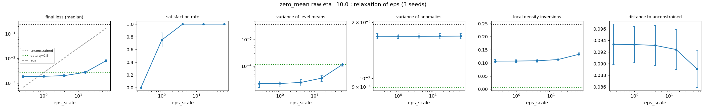

# Preliminaries: experiments and results (2026-10-14)

This document lists the experiments run for the preliminary questions of `../analytic_approach.md` and the results obtained. It contains no interpretation. The figures are produced by `report_figures.py` (except `eps_data_hist.png`, `eps_data.py`, and `relax_zero_mean.png`, `plot_relax.py`), and the tables come from `outputs/sweep_table.csv`, `outputs/local_metrics.csv`, `outputs/compare_100steps_all.csv` and `outputs/compare_1000steps_all.csv`.

## Setting

- Model `tav0h83b`, DDPM sampling with 100 steps (runs of this session, `prelim_sweep_clip/`) or 1000 steps (runs of the generation-pipeline session, `test_new_sampler_clip/`);
- Batch of size 8, seed 0 unless stated otherwise;
- `BorderZero` projection on every run, Tweedie estimate x0_hat clipped to [-1, 1];
- Primal-dual guidance: one dual variable per sample and per constraint, updated with step eta. In raw mode g = loss - eps, in sqrt mode g = sqrt(loss) - sqrt(eps);
- eps is a quantile of the losses on the 1800 training states (q0.5 by default), multiplied by `eps_scale` for the relaxation runs;
- Joint projection: post-hoc LBFGS (`OptimProjection`, 10 steps, eps = 0) on `mean_density + c * dist_isoton`, then `BorderZero` (`joint_projection.py`);
- `final_opt`: post-hoc LBFGS on the guided loss until loss < eps.

All runs are stored in `$OCEANDATA/models/dino-fusion/tav0h83b/inference/{prelim_sweep_clip,test_new_sampler_clip}/<run>/generated.npy` (normalised states, shape (b, 37, 208, 64)).

## Metrics

- Losses: median over the batch of each of the five losses of `pipelines/losses.py`;
- Satisfaction: fraction of the batch with loss <= eps;
- Distance: RMS over ocean cells of the difference with the unconstrained state of the same seed;
- Diversity: mean over ocean cells of the standard deviation over the batch;
- Level-mean variance: variance over the batch of the per-level spatial means;
- Anomaly variance: variance over the batch of the spatial anomalies to these means;
- Inversions: fraction of vertical pairs of ocean cells (strided levels) where the density decreases with depth, with and without a 0.01 kg/m3 tolerance;
- Roughness: mean squared difference between neighbouring ocean cells.

Reference values:

| | inversions | inversions > 0.01 | level-mean variance | anomaly variance | diversity | roughness | distance |
|---|---|---|---|---|---|---|---|
| data (random batches of 8) | 0.63 % | 0 | 1.15e-4 | 8.9e-4 | 0.022 | 1.2e-3 | 0.044 (two states) |
| unconstrained, 100 steps (3 seeds) | 24.4-25.1 % | 22.2-23.2 % | 3.4e-3 to 4.1e-3 | 1.9e-3 to 2.0e-3 | 0.067-0.071 | 2.9e-3 to 3.0e-3 | 0 |
| unconstrained, 1000 steps | 26.3 % | 24.5 % | 3.9e-3 | 2.2e-3 | 0.071 | 3.1e-3 | 0 |

## E0 - Losses on the training data

Experiment: the five losses evaluated on the 1800 training states (`eps_data.py`).

| loss | q0.5 | q0.9 | q1.0 | unconstrained, 100 steps (median) |
|---|---|---|---|---|
| mean_density | 6.3e-3 | 1.3e-2 | 2.7e-2 | 1.32 |
| mean_grad_density | 1.5e-3 | 1.9e-3 | 2.2e-3 | 0.92 |
| negative_grad_density | 0 | 0 | 0 | 0.40 |
| zero_mean | 2.6e-3 | 8.2e-3 | 1.1e-2 | 0.24 |
| dist_isoton | 3.5e-5 | 3.8e-5 | 4.3e-5 | 6.6e3 |

`negative_grad_density` is 0 on 100 % of the training states. eps is floored at 1e-6 for this loss in all runs.

## E1 - Single constraint, eta sweep, raw and sqrt modes

Experiment: each loss alone, eps = q0.5, eta on a log grid, raw and sqrt modes, 100 steps.

Best final loss per loss and mode:

| loss | raw: eta, loss, satisfaction, distance | sqrt: eta, loss, satisfaction, distance |
|---|---|---|
| mean_density | 1, 2.65e-2, 0, 0.602 | 1, 1.25e-2, 0, 0.062 |
| mean_grad_density | 0.1, 0.187, 0, 0.234 | 1, 1.0e-2, 0, 0.053 |
| negative_grad_density | 10, 9.6e-4, 0, 0.563 | 10, 0, 0.88, 0.225 (eta 1: 4e-5, 0.25, 0.040) |
| zero_mean | 10, 1.8e-3, 0.88, 0.091 | 10, 5.1e-6, 1, 0.093 |
| dist_isoton | 1e-8, 76, 0, 0.533 | 1e-4, 4.8, 0, 0.073 |

Additional measurements:
- Before the x0_hat clip was added, every constrained run returned NaN states (`test_new_sampler/`);
- raw mode, mean_density, eta 1: zero_mean of the final states is 9.4 (unconstrained 0.24);
- raw, mean_density eta 10 and mean_grad_density eta 1 and 10: final loss between 80 and 5e11, diversity between 0.75 and 1.9;
- dist_isoton raw eta >= 1e-7 and sqrt eta >= 1e-2: losses above 1e19 or infinite;
- sqrt mode, mean_density eta 1: the loss of x0_hat reaches 5e-3 at t = 90, the final state is at 1.25e-2;
- maximal dual variable at large eta: about 40 at 100 steps and 185 at 1000 steps;
- zero_mean raw eta 10: the other losses of the final states are mean_density 1.35e-2, negative_grad_density 6.6e-5, dist_isoton 56;
- dist_isoton sqrt eta 1e-4 (3 seeds): inversions 4.8-5.4 %, level-mean variance 1.8e-3 to 2.2e-3, mean_density 0.63-0.93;
- 1000 steps (generation session): mean_density sqrt eta 0.1 gives 4/8 satisfied, profile_rmse 0.020 (data 0.024). dist_isoton sqrt eta 5e-6 gives profile_rmse 2x the unconstrained value and zero_mean 2x to 7x.

## E2 - Sampler variants

Experiment: `t_start` (guidance only for t < t_start), `lbd_max` (clip of the dual variable), `through_unet = False` (no UNet Jacobian), `final_opt`, on mean_density, 100 steps.

| mode, eta | variant | mean_density | satisfaction | distance | time |
|---|---|---|---|---|---|
| raw 0 | final_opt 10 (post-hoc) | 2.28e-3 | 1 | 0.044 | 41s |
| raw 0.01 | none | 0.276 | 0 | 0.044 | 37s |
| raw 0.01 | t_start 700 | 0.575 | 0 | 0.016 | 49s |
| raw 0.01 | t_start 400 | 1.07 | 0 | 0.004 | 37s |
| raw 0.01 | through_unet False | 0.287 | 0 | 0.042 | 29s |
| raw 0.01 | final_opt 10 | 3.07e-3 | 1 | 0.055 | 57s |
| raw 0.1 | none | 0.467 | 0 | 0.309 | 37s |
| raw 0.1 | t_start 700 | 0.156 | 0 | 0.039 | 48s |
| raw 0.1 | t_start 400 | 0.336 | 0 | 0.024 | 36s |
| raw 0.1 | lbd_max 2 / 5 | 0.335 / 1.31 | 0 | 0.062 / 0.196 | 56s |
| raw 0.1 | through_unet False | 0.281 | 0 | 0.334 | 29s |
| raw 1 | none | 2.65e-2 | 0 | 0.602 | 37s |
| raw 1 | lbd_max 2 / 5 | 0.335 / 1.39 | 0 | 0.062 / 0.205 | 55s |
| sqrt 1 | none | 1.25e-2 | 0 | 0.062 | 55s |
| sqrt 1 | t_start 700 | 8.8e-3 | 0.125 | 0.054 | 31s |
| sqrt 1 | through_unet False | 8.4e-3 | 0.25 | 0.059 | 19s |
| sqrt 1 | lbd_max 20 | 2.6e-2 | 0 | 0.060 | 37s |
| sqrt 1 | final_opt 10 | 1.9e-3 | 1 | 0.063 | 38s |

With `final_opt` on mean_density raw eta 0.01, 90 % of the correction is a uniform shift per level. On dist_isoton sqrt eta 1e-4, `through_unet = False` gives 5.3 % of inversions (5.4 % with the Jacobian) and is 40 % faster, and `t_start = 300` with eta 1e-3 gives 8.4 % of inversions at distance 0.044.

## E3 - Combined constraints, 100 steps

Experiment: `dist_isoton + zero_mean` (and `+ mean_density`), sqrt mode, one dual variable per constraint (`pd_explore.Stacked`), eps = q0.5 unless stated, three seeds for the main configurations. The zero_mean eps is then relaxed (x64, x128, x256, two seeds), and the joint projection (c = 0.01) is applied on some runs.

| config (eta iso, eta zm[, eta md]) | inversions | inversions > 0.01 | level-mean variance | anomaly variance | diversity | zero_mean | mean_density | dist_isoton |
|---|---|---|---|---|---|---|---|---|
| iso + zm (1e-4, 1), 3 seeds | 2.4-2.6 % | 0.80-0.85 % | 7.4e-5 to 8.4e-5 | 1.7e-3 | 0.031 | 6.4e-3 to 7.8e-3 | 0.058-0.063 | 4.6-4.8 |
| same + final_opt 10 (seed 0) | 0.39 % | 0 | 7.4e-5 | 1.7e-3 | 0.031 | 8.0e-3 | 0.065 | 1.1e-3 |
| same + joint (seeds 0, 1) | 2.0-2.4 % | 0.002-0.003 % | 6.7e-5 to 7.7e-5 | 1.7e-3 | 0.031 | 5.0e-3 to 5.4e-3 | 8.8e-4 to 9.1e-4 | 8.5e-3 to 1.1e-2 |
| iso + zm (1e-4, 3), 3 seeds | 4.8-5.1 % | 1.4-1.6 % | 1.8e-7 to 4.2e-7 | 1.6e-3 to 1.7e-3 | 0.027-0.029 | 1.1e-5 to 3.5e-5 | 4.4e-3 to 4.7e-3 | 6.6-7.0 |
| iso + zm (1e-4, 10), 3 seeds | 5.1-5.9 % | 2.3-3.0 % | 1.9e-7 to 3.3e-7 | 1.5e-3 to 1.7e-3 | 0.026-0.029 | 1.7e-5 to 2.2e-5 | 4.7e-3 to 4.8e-3 | 7.2-7.7 |
| iso + zm (3e-5, 1), 3 seeds | 5.9-6.1 % | 2.7-2.9 % | 8.5e-5 to 9.0e-5 | 1.7e-3 | 0.030-0.031 | 5.6e-3 to 7.4e-3 | 0.027-0.029 | 8.8-9.2 |
| iso + zm (1e-4, 1), zm eps x64 | 2.7-2.8 % | 0.94-0.99 % | 3.3e-4 to 3.7e-4 | 1.7e-3 | 0.036 | 0.031-0.032 | 0.22-0.24 | 3.4-3.5 |
| same + joint | 2.9-3.2 % | 0.010-0.012 % | 3.0e-4 to 3.5e-4 | 1.7e-3 | 0.035-0.036 | 0.021-0.024 | 3.0e-3 to 3.4e-3 | 0.017-0.019 |
| iso + zm (1e-4, 1), zm eps x128 | 3.0-3.2 % | 1.2 % | 5.4e-4 to 6.0e-4 | 1.7e-3 | 0.039 | 0.048-0.052 | 0.34-0.36 | 3.1-3.4 |
| same + joint | 3.4-4.2 % | 0.017-0.027 % | 4.8e-4 to 5.7e-4 | 1.7e-3 | 0.038-0.039 | 0.035-0.039 | 4.3e-3 to 5.1e-3 | 0.026-0.033 |
| iso + zm (1e-4, 1), zm eps x256 | 3.6-4.0 % | 1.6-1.7 % | 9.2e-4 to 1.0e-3 | 1.7e-3 | 0.044-0.045 | 0.079-0.082 | 0.55-0.57 | 3.2-3.6 |
| same + joint | 4.0-4.5 % | 0.042-0.053 % | 8.2e-4 to 9.7e-4 | 1.8e-3 | 0.043-0.044 | 0.057-0.064 | 6.4e-3 to 8.4e-3 | 0.043 |
| iso + zm + md (1e-4, 1, 0.1) | 4.6 % | 1.4 % | 4.5e-5 | 1.5e-3 | 0.028 | 3.9e-3 | 2.3e-3 | 6.3 |
| iso + zm + md (1e-4, 1, 0.3) | 6.0 % | 3.6 % | 4.2e-5 | 1.6e-3 | 0.029 | 3.7e-3 | 1.5e-3 | 10.3 |
| iso + zm + md (1e-4, 1, 1) | 9.3 % | 8.0 % | 9.3e-5 | 1.5e-3 | 0.029 | 1.3e-2 | 2.5e-2 | 182 |
| iso + zm + md (2e-4, 1, 0.3) | 8.2 % | 6.8 % | 6.0e-5 | 1.6e-3 | 0.029 | 1.2e-2 | 3.0e-2 | 152 |
| iso + zm + md (3e-4, 1, 0.3) | 9.2 % | 7.9 % | 6.6e-5 | 2.3e-3 | 0.035 | 4.9e-2 | 9.0e-2 | 422 |
| iso + zm + md (1e-4, 0.5, 1) | 9.4 % | 7.8 % | 3.9e-4 | 1.6e-3 | 0.035 | 5.9e-2 | 2.2e-2 | 160 |
| iso + md (1e-4, 1) | 9.9 % | 7.7 % | 1.3e-3 | 1.7e-3 | 0.046 | 0.17 | 2.0e-2 | 113 |
| iso + md (3e-5, 1) | 10.9 % | 7.8 % | 1.5e-3 | 1.7e-3 | 0.049 | 9.2e-2 | 4.4e-3 | 18 |
| zm raw 10 alone, 3 seeds | 10.2-11.4 % | 7.8-8.8 % | 1.8e-5 to 2.9e-5 | 1.6e-3 to 1.7e-3 | 0.028-0.029 | 1.5e-3 to 2.0e-3 | 1.3e-2 to 1.8e-2 | 48-56 |
| md sqrt 1 alone, 3 seeds | 13.9-15.6 % | 11.5-13.1 % | 1.8e-3 to 2.4e-3 | 1.7e-3 to 1.9e-3 | 0.052-0.058 | 0.10-0.12 | 6.9e-3 to 1.6e-2 | 101-246 |
| iso + zm (1, 1) and (1, 10) | 30-31 % | 29-30 % | 1e3 | 6e4 | 73 | | | |

## E4 - Combined constraints, 1000 steps

Runs of the generation-pipeline session, `dist_isoton` sqrt eta 5e-6 + `zero_mean` sqrt, seed 0, metrics from `compare_runs.py`.

### zero_mean eta, eps = q0.5

| eta iso, eta zm | inversions | inversions > 0.01 | level-mean variance | mean_density | zero_mean |
|---|---|---|---|---|---|
| 5e-6, 0.01 | 2.03 % | 0.62 % | 8.0e-5 | 0.215 | 2.1e-2 |
| 5e-6, 0.02 | 6.09 % | 2.38 % | 7.1e-7 | 6.1e-3 | 1.2e-4 |
| 5e-6, 0.05 | 5.40 % | 1.82 % | 5.5e-7 | 5.3e-3 | 7.0e-5 |
| 5e-6, 0.1 | 5.14 % | 1.61 % | 4.1e-7 | 4.8e-3 | 5.1e-5 |
| 2e-6, 0.1 | 7.01 % | 3.95 % | 5.5e-7 | 4.3e-3 | 8.0e-5 |

### zero_mean eps relaxation, eta (5e-6, 0.1), with and without joint projection

| zero_mean eps | | inversions | inversions > 0.01 | level-mean variance | anomaly variance | mean_density | zero_mean |
|---|---|---|---|---|---|---|---|
| x1 | guided | 5.14 % | 1.61 % | 4.1e-7 | 1.8e-3 | 4.8e-3 | 5.1e-5 |
| x16 | guided | 2.69 % | 0.81 % | 7.0e-6 | 1.7e-3 | 4.3e-2 | 3.0e-3 |
| x64 | guided | 2.00 % | 0.60 % | 2.9e-5 | 1.9e-3 | 0.111 | 8.3e-3 |
| x64 | + joint c = 0.01 | 1.55 % | 0.002 % | 2.6e-5 | 1.9e-3 | 5.6e-4 | 4.3e-3 |
| x64 | + joint c = 0.1 | 2.26 % | 0.017 % | 2.7e-5 | 1.9e-3 | 7.6e-3 | 5.1e-3 |
| x64 | + final_opt 10 | 8.30 % | 5.97 % | 2.6e-5 | 1.9e-3 | 2.3e-3 | 4.1e-3 |
| x256 | guided | 1.59 % | 0.50 % | 5.9e-5 | 2.0e-3 | 0.347 | 1.7e-2 |
| x256 | + joint c = 0.01 | 2.25 % | 0.006 % | 5.0e-5 | 2.0e-3 | 1.0e-3 | 8.1e-3 |
| x512 | guided | 1.35 % | 0.43 % | 9.4e-5 | 1.9e-3 | 0.671 | 3.5e-2 |
| x512 | + joint c = 0.01 | 2.27 % | 0.0025 % | 7.8e-5 | 1.9e-3 | 2.2e-3 | 1.8e-2 |
| x1024 | guided | 1.40 % | 0.43 % | 3.7e-4 | 1.9e-3 | 1.53 | 0.111 |
| x1024 | + joint c = 0.01 | 2.35 % | 0.027 % | 3.0e-4 | 1.9e-3 | 9.5e-3 | 7.4e-2 |
| unconstrained | | 26.3 % | 24.5 % | 3.9e-3 | 2.2e-3 | 1.33 | 0.244 |

Roughness is between 3.1e-3 and 3.4e-3 and distance between 0.103 and 0.111 for all these runs. profile_rmse after the joint projection: 0.007 (x64), 0.009 (x256), 0.011 (x512), 0.022 (x1024), data 0.024.

### Guided triple

| eta iso, eta zm (eps x64), eta md | inversions | inversions > 0.01 | level-mean variance | anomaly variance | mean_density |
|---|---|---|---|---|---|
| 5e-6, 0.1, 0.03 | 4.99 % | 1.18 % | 2.5e-5 | 3.0e-3 | 2.8e-4 |
| 5e-6, 0.1, 0.1 | 7.12 % | 5.19 % | 1.2e-5 | 2.3e-3 | 1.3e-3 |

## E5 - Guidance vs. post-hoc projection

Experiment: unconstrained states (seed 0) followed by `OptimProjection` (10 steps) on one loss, compared with the guided runs of the same loss, at 100 and 1000 steps.

| loss | steps | post-hoc inversions | guided inversions (eta) | guided + final_opt |
|---|---|---|---|---|
| mean_density | 100 | 14.3 % | 15.6 % (sqrt 1) | |
| negative_grad_density | 100 | 20.7 % | 18.7 % (sqrt 1) | |
| zero_mean | 100 | 12.7 % | 10.2 % (raw 10) | |
| mean_density | 1000 | 14.8 % | 12.7 % (sqrt 0.1) | 11.6 % |
| negative_grad_density | 1000 | 19.7 % | 16.5 % (sqrt 0.1), 12.8 % (sqrt 0.3) | |
| zero_mean | 1000 | 12.8 % | 10.3 % (raw 0.4), 9.8 % (raw 1) | |

On mean_density at 100 steps, post-hoc and guided + final_opt both satisfy 8/8 samples, with distance 0.044 to 0.055 and diversity 0.055 in both cases. The density_errors metric of the generation session gives 7.5 % (post-hoc) and 4.0 % (guided) for negative_grad_density at 1000 steps.

## E6 - Relaxation of zero_mean alone, 100 steps

Experiment: zero_mean raw eta 10, eps = eps_scale x q0.5, eps_scale in {0.25, 1, 4, 16, 64}, three seeds.

| eps_scale | 0.25 | 1 | 4 | 16 | 64 | data | unconstrained |
|---|---|---|---|---|---|---|---|
| zero_mean (median) | 1.8e-3 | 1.85e-3 | 2.0e-3 | 2.7e-3 | 8.1e-3 | 2.6e-3 | 0.24 |
| satisfaction | 0 | 0.78 | 1 | 1 | 1 | | |
| level-mean variance | 2.2e-5 | 2.1e-5 | 2.4e-5 | 3.5e-5 | 1.15e-4 | 1.15e-4 | 3.4e-3 to 4.1e-3 |
| anomaly variance | 1.69e-3 | 1.69e-3 | 1.69e-3 | 1.69e-3 | 1.69e-3 | 8.9e-4 | 1.9e-3 |
| inversions | 10.7 % | 10.6 % | 10.8 % | 11.3 % | 13.3 % | 0.6 % | 25 % |

Variance split of the unconstrained runs: 64-68 % of the total variance is in the level means. Roughness of every generation (100 and 1000 steps, constrained or not): 2.8e-3 to 3.4e-3, data 1.2e-3.
